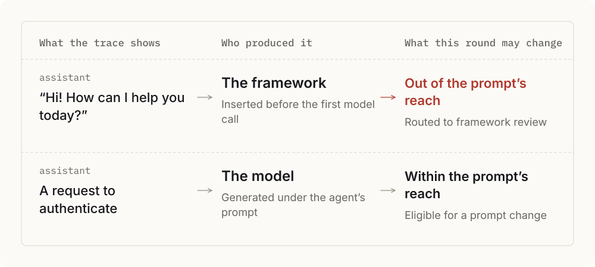
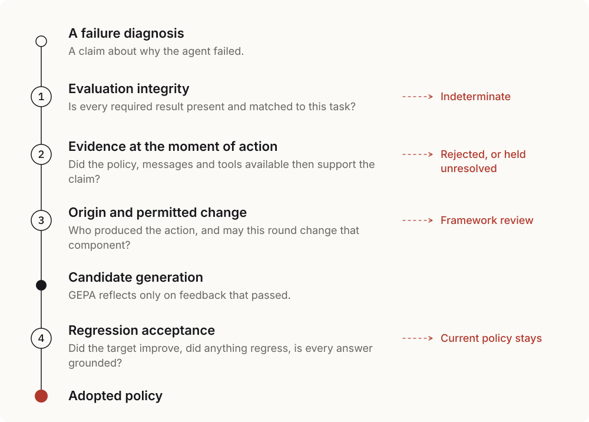

# Agent Evaluation Methodology

**A critique can be true and still have no right to change the agent.**

An optimizer reads a failed trace, a reviewer explains the failure, and the explanation becomes a new prompt. That loop assumes the thing being criticized is the thing being changed. I found that assumption breaking inside a widely used benchmark, then built **Intervention-Constrained Feedback Admission (ICFA)** to repair it: a method and a working gate between evaluation feedback and GEPA’s prompt optimizer.

## The Finding

In τ2-bench retail, a diagnosis faulted the agent for greeting the customer instead of requesting authentication at once. The source code and the execution records told a different story: the framework inserts that greeting before the first model call, and the agent’s first real reply did ask for authentication.

I tested the boundary directly. Across 12 tasks and 3 different agent prompts, all 36 official initializations produced the same opening, with zero model calls. A prompt cannot rewrite a message that exists before the prompt is ever read.

**The role label on a message, the component that produced it, and the component this round may change are three separate facts.** Merge them, and an optimizer receives a persuasive instruction it has no power to carry out.

## The Design

ICFA treats every diagnosis as a claim that must earn its way into the optimizer. Each gate removes a different way of being wrong, and each has its own exit, so a rejected diagnosis still says where it should go.

- **Integrity comes first** because a missing result must never be read as a pass.
- **Evidence is limited to the moment of action** so that hidden answers and hindsight cannot assign blame.
- **Origin is checked against the permitted change** because eligibility is relative to the intervention. The same diagnosis can be useless for a prompt round and essential for a framework review.
- **Acceptance is a separate decision.** Admission asks whether feedback may guide a change. Acceptance asks whether the change deserves to stay.

## The Evidence

| Study | Result | What it establishes |
|---|---|---|
| Origin audit of real traces | 181 of 181 assistant messages bound to their source: 18 framework, 163 model | Origin can be established message by message |
| Controlled initialization | 36 of 36 identical openings across 12 tasks and 3 prompts, with no model calls | A prompt cannot reach a framework-inserted message |
| Evaluation integrity | 120 valid controls preserved, 440 predefined anomalies marked unknown | Missing evidence is never read as success |
| Sealed synthetic admission | Admitted 5 of 5 supported claims, 0 of 3 refuted, 1 of 4 with insufficient evidence | The origin check removes what semantic review alone lets through |
| Live candidate pilot | Passed both official tasks while promising a refund deadline with no basis in policy | Task score and answer quality need separate acceptance |

These studies establish the mechanism and its boundary. The next study measures its effect on task success and optimization cost at scale.

## The Mathematics

Let $p$ be the share of valid feedback, $t$ the share of valid feedback a gate keeps, and $f$ the share of invalid feedback it lets through. Then

$$
P(\text{valid}\mid\text{admitted})=\frac{pt}{pt+(1-p)f}.
$$

Precision rises exactly when $t>f$. Rejecting more proves nothing. A gate earns its place only by telling valid feedback from invalid feedback, which is why ICFA is built to preserve uncertainty instead of forcing a verdict.

## Read the Work

[Research report (Chinese)](core/04-icfa-report/README.md) · [Framework-opening finding](core/03-tau-feedback-evidence/E4_ACTION_ORIGIN_REVIEW.md) · [Synthetic admission study](core/03-tau-feedback-evidence/C1_SYNTHETIC_RESULT.md) · [System specification](supporting-evidence/tau-feedback-evidence/research/SYSTEM_SPECIFICATION.md) · [Reproduction package](supporting-evidence/tau-feedback-evidence/README.md)

Conducted May to September 2026. [τ2-bench](https://arxiv.org/abs/2506.07982) supplies the task environment and evaluation machinery, and [GEPA](https://arxiv.org/abs/2507.19457) supplies reflective prompt optimization. Their attribution and license notices are retained in [THIRD_PARTY_NOTICES](supporting-evidence/tau-feedback-evidence/THIRD_PARTY_NOTICES.md).
